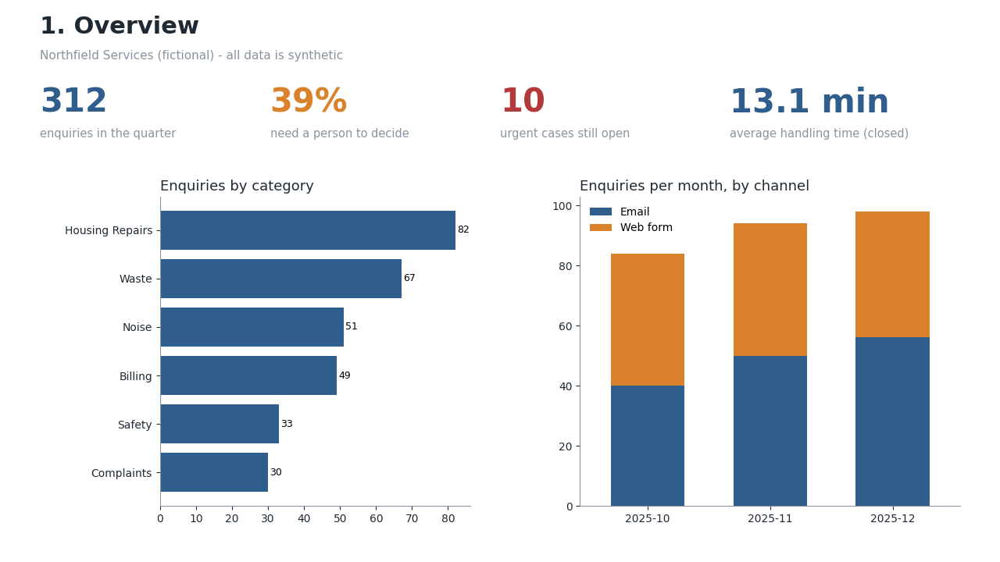
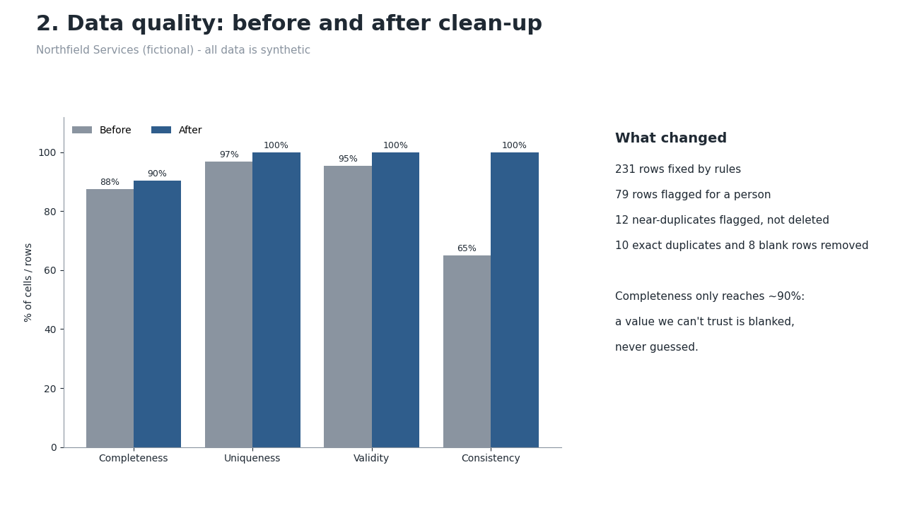
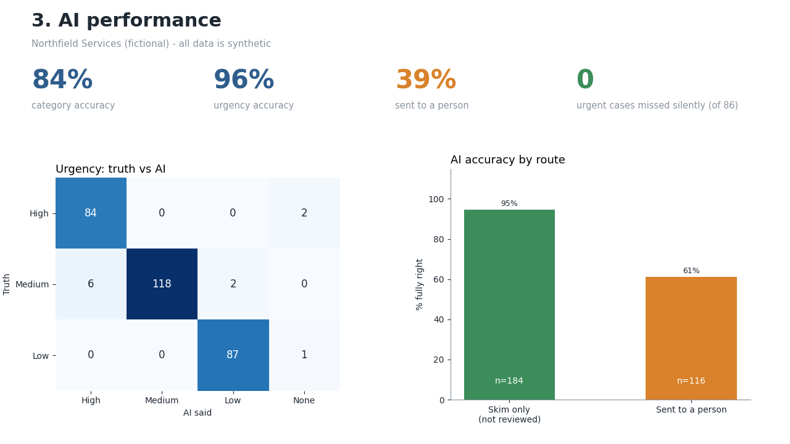
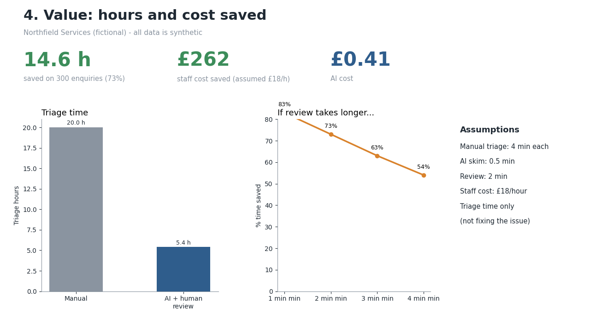

# AI-Ready Operations Pipeline (Microsoft Edition)

> **I make AI work in real organisations. I clean the data, keep humans in control, and prove the savings.**

A portfolio project that tests one claim on **synthetic data**: *clean data + AI triage + human review + honest measurement can cut handling time while keeping people in control.*

**All data is made up.** "Northfield Services" is a fictional council contact centre. No real people, companies or logos are used.

## The problem

A public-service provider handles thousands of enquiries. Its data is messy (blanks, wrong formats, duplicates, details buried in free text), triage is slow and manual, and managers struggle to report contract performance. AI pilots stall because the data isn't ready, nobody trusts the outputs, and nobody can prove the savings.

## How it works

```
Messy legacy sheet ─► 1 Clean & score (Python) ─► 2 SQL tables (SQLite / Fabric)
                                                        │
        7 Power BI report ◄─ 6 Evaluation (SQL) ◄─ 3 AI triage (Claude, validated JSON; masked text only)
                                                        │
                                  4 Human review queue (n8n + Google Sheet / CSV) ─► 5 Audit log of every step
```

## Honest status

| Phase | What | State |
|---|---|---|
| 0 | Setup, Git, demo mode | **Done and tested** |
| 1 | Messy synthetic data + answer key | **Done and tested** |
| 2 | Data clean-up, scoring, PII masking | **Done and tested** |
| 3 | SQL tables, loader, 9 manager queries | **Done and tested** |
| 4 | AI triage (pydantic, retry, cost guard) | **Done and tested with the real Claude API** (312 enquiries, about £0.41), plus the keyword stand-in and a chat-session run for comparison |
| 5 | Human review loop + audit log | **Local version tested**; the n8n workflow is drafted, **not run** (no Docker or Google account here) |
| 6 | Evaluation vs answer key, time saved | **Done** on the real API run (see Results) |
| 7 | Power BI report | **Not built.** Data model, DAX and page designs are ready (`powerbi/BUILD_GUIDE.md`); the four pages are drawn in Python as previews, not Power BI |
| 8 | Microsoft Fabric edition | **Prepared, not run.** Notebooks, T-SQL and a step-by-step guide are in `fabric/` |
| 9 | Packaging | README, case study, video script and CV notes done; **video not recorded** |

## Results

Three triage runs on the same 300 synthetic enquiries, scored against the same answer key.

| | A. Keyword stand-in | B. Claude in a chat session | **C. Claude API (Haiku 5.5)** |
|---|---|---|---|
| Category accuracy | 97% | 99% | **84%** |
| Urgency accuracy | 99% | 98% | **96%** |
| Urgent cases missed without a person seeing them (of 86) | 0 | 0 | **0** |
| Enquiries sent to a person | 62% | 34% | **39%** |
| Accuracy of cases handled with only a skim | 100% | 100% | **95%** |
| Estimated triage time saved | 64% | 75% | **73%** |
| Cost | £0 | £0 | **about £0.41** (312 calls; price figures assumed, check your Console) |

**Run C is the one to quote.** It runs this project's own code (`src/triage.py`) against the real Claude API on masked text only. Runs A and B are kept as comparisons: A is a keyword matcher, and B was Claude reading the data in a chat, written by the same assistant that wrote the data, so it was not independent and **overstated** what a real model scores. The real model scored 15 points lower on category.

**Where Claude (run C) went wrong, and why**
- **32 of 47 category misses are "Safety" used for High-urgency cases** the answer key files under Housing Repairs (water pouring through a ceiling), Waste (needles and glass in a play area) or Noise (violent shouting, children at risk). Reasonable people could label those Safety, so part of this is a weakness in forcing one label per enquiry. All 32 went to a person, because Safety cases are always reviewed, so nothing urgent was lost.
- **10 of the 184 cases handled with only a skim were wrong (5.4%).** Seven are one message about a confusing website and a bulky-waste form (Claude said Waste, the key says Complaints); the others are minor urgency or category slips (for example, a double council-tax charge rated Low rather than Medium). None was urgent.
- **3 empty messages** could not be triaged and went to a person, as designed.

What this shows: the review rule worked (no urgent case slipped through), but a 5% silent error rate on easy data means real-world monitoring and a sample check of the un-reviewed cases would be essential.

**After a human review step** (a *simulated* reviewer who knows the answers, so a best case): category 97%, urgency 99%.

**Value** (assumptions in `docs/results.md`): run C saves about **73% of triage time** (20.0 h -> 5.4 h on 300 enquiries) assuming 4 min manual, 0.5 min skim, 2 min review, £18/h, less about £0.41 of AI cost. The saving depends heavily on the review-time assumption (sensitivity table in the results). Triage time only, not fixing the issue.

**Data quality** (330 raw rows -> 312 cleaned):

| Measure | Before | After |
|---|---|---|
| Completeness | 87.5% | 90.4% |
| Uniqueness | 96.9% | 100% |
| Validity | 95.5% | 100% |
| Consistency | 64.9% | 100% |

Checked against the answer key: **1 wrong value in about 3,300 cleaned cells**. Anything untrustworthy was blanked and flagged, never guessed.

**Two bugs found along the way (both fixed).** (1) The personal-detail masking missed street names in lower-case text, and my first leak check only covered the 300 original rows; I made the masking case-insensitive and widened the check to all 312 rows, which now finds no leaks. (2) The first real API call crashed because the reply started with a "thinking" block my code didn't expect; demo mode could never have shown that.

**Still limited:** the data is synthetic and template-based (about 34 templates), so real enquiries will be harder; the reviewer is simulated; the time saving rests on assumptions. The raw API output is in `data/triage_api/ai_triage_claude_haiku.csv`.

Full detail: [docs/results.md](docs/results.md) | [where it was wrong](docs/error_analysis.md) | [data quality report](data/clean/quality_report.md) | [example audit trail](docs/example_audit_trail.txt)

### Report pages (Python previews of the planned Power BI pages)

| | |
|---|---|
|  |  |
|  |  |

## Run it (no API key needed)

```bash
python3 -m venv .venv
source .venv/bin/activate
pip install -r requirements.txt
python src/run_all.py          # everything, in order, in a few seconds (keyword stand-in)
python src/run_all.py --session   # same, but with the Claude-in-chat triage answers
```

Or one step at a time:

```bash
python src/generate_data.py    # messy data + answer key
python src/data_quality.py     # clean, score, mask
python src/load_sql.py         # build data/northfield.db
python src/triage.py           # AI triage (real Claude with a key in .env, keyword stand-in without)
python src/import_triage.py    # OR: load the Claude-in-chat answers instead
python src/review_queue.py all # review queue, simulated reviewer, replies, audit log
python src/evaluate.py         # results + CSVs for Power BI
python src/run_queries.py      # manager questions answered in SQL
```

**Demo mode:** with no `ANTHROPIC_API_KEY` in `.env`, the AI steps use keyword rules. To use Claude, copy `.env.example` to `.env`, paste your key, then `python src/triage.py --redo --limit 20` to try 20 first. The run estimates its cost and stops before £2 (price figures in `ai_client.py` are assumptions; check the Claude Console). Never commit `.env`.

Tested with Python 3.9 on macOS (pandas 2.3, pydantic 2.13, anthropic 0.125).

## Safeguards built in

- **Personal details are masked before any text reaches an AI.** A leak check against the answer key found none.
- **The AI only suggests; a person decides.** Code (not the AI) forces review for low confidence, High urgency and Safety.
- **Never invent data.** Unfixable values are blanked, flagged and logged with the original.
- **Everything is logged.** Cleaning changes, AI answers, human decisions and replies all land in the audit log.
- **Validated output.** The AI's JSON is checked by pydantic, retried once, and failures go to a person.
- **Cost guard.** Tokens counted, £2 stop.

## Folder guide

```
src/          the Python code (run_all.py runs it all)
sql/          create_tables.sql, metrics_queries.sql, evaluation_queries.sql
data/         raw/ (messy) · clean/ (outputs + reports) · ground_truth/ (answer key) · review/ (queue)
n8n/          workflow.json (draft) + set-up notes
powerbi/      BUILD_GUIDE.md and data/ (CSV files for the report)
fabric/       notebooks/, sql/, FABRIC_GUIDE.md
docs/         results, error analysis, case study, video script, CV notes, screenshots
```

## Limitations

- Synthetic, template-based data: real enquiries are harder. Real-world accuracy will probably be lower.
- The real-Claude results are on synthetic, template-based data, so real enquiries will be harder. Only one model (Haiku 5.5) and one prompt were tried.
- The reviewer in the demo is simulated and knows the answers (a best case).
- Time-saved figures rest on assumptions, not measurement in a real contact centre.
- Dates are read day-first (UK). Postcodes are checked for shape and a real area, not against a full postcode database (this caused the one wrong value).
- Not production-ready: no authentication, no data-protection review, no retention policy.

## What I would do next with real data

1. Try a better prompt, allow a second category label for overlapping cases (e.g. Safety plus Housing), and test Sonnet where Haiku struggles.
2. Add a harder test set (typos, two issues in one message, very short messages).
3. Sample the cases the AI handled *without* review every week to catch drift.
4. Tune the confidence threshold against the cost of a missed urgent case.
5. Complete the Power BI report and the Fabric run, with real screenshots.
6. Re-test on a harder dataset that someone else wrote.

## Built with AI assistance

Built with Claude Code as a learn-by-building project by someone new to coding. The plan is to learn the underlying skills next, then rebuild the clean-up script, the Claude call, three SQL queries and one report page from scratch. See [LEARNING_NOTES.md](LEARNING_NOTES.md).
