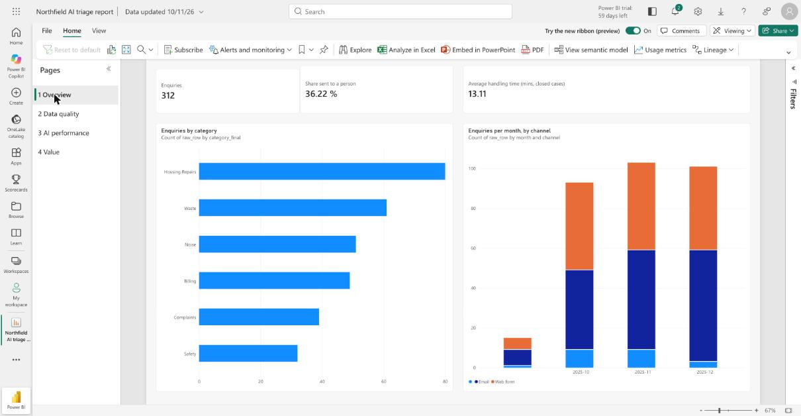
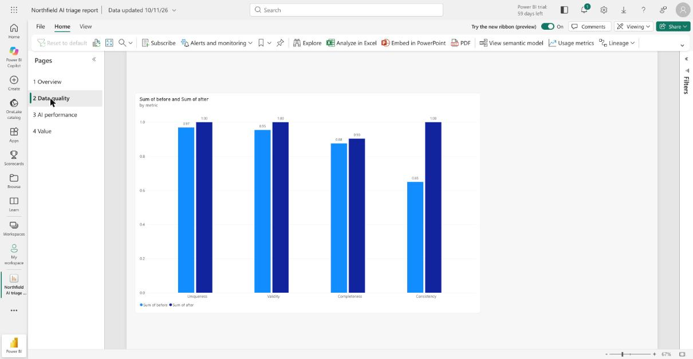
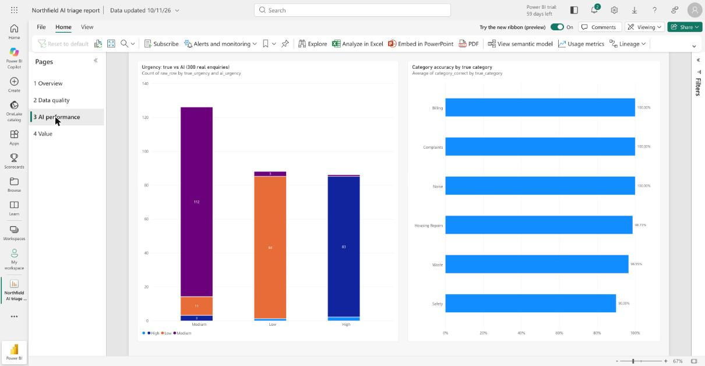
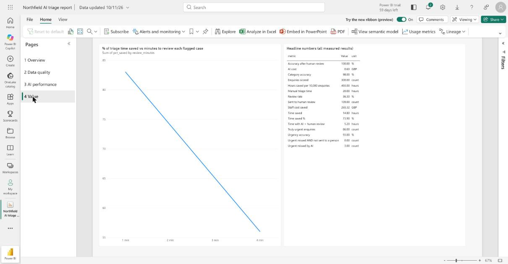

# AI-Ready Operations Pipeline (Microsoft Edition)

> **I make AI work in real organisations. I clean the data, keep humans in control, and prove the savings.**

A portfolio project that tests one claim on **synthetic data**: *clean data + AI triage + human review + honest measurement can cut handling time while keeping people in control.*

**All data is made up.** "Northfield Services" is a fictional council contact centre. No real people, companies or logos are used.

## The problem

A public-service provider handles thousands of enquiries. Its data is messy (blanks, wrong formats, duplicates, details buried in free text), triage is slow and manual, and managers struggle to report contract performance. AI pilots stall because the data isn't ready, nobody trusts the outputs, and nobody can prove the savings.

## How it works

```
Messy legacy sheet ─► 1 Clean & score (Python) ─► 2 SQL tables (SQLite / Fabric)
                                                        │
        7 Power BI report ◄─ 6 Evaluation (SQL) ◄─ 3 AI triage (Claude, validated JSON; masked text only)
                                                        │
                                  4 Human review queue (n8n + Google Sheet / CSV) ─► 5 Audit log of every step
```

## Honest status

| Phase | What | State |
|---|---|---|
| 0 | Setup, Git, demo mode | **Done and tested** |
| 1 | Messy synthetic data + answer key | **Done and tested** |
| 2 | Data clean-up, scoring, PII masking | **Done and tested** |
| 3 | SQL tables, loader, 9 manager queries | **Done and tested** |
| 4 | AI triage (pydantic, retry, cost guard) | **Done and tested with the real Claude API** (312 enquiries, about £0.41), plus the keyword stand-in and a chat-session run for comparison |
| 5 | Human review loop + audit log | **Local version tested**; the n8n workflow is drafted, **not run** (no Docker or Google account here) |
| 6 | Evaluation vs answer key, time saved | **Done** on the real API run (see Results) |
| 7 | Power BI report | **Built in the Power BI service** (4 pages, from this repo's CSVs; real screenshots below). No `.pbix` file (Power BI Desktop is Windows-only), and the web editor can't create custom DAX measures, so it uses built-in aggregations. Titles, labels and month order were polished; some default subtitles remain |
| 8 | Microsoft Fabric edition | **Prepared, not run.** Notebooks, T-SQL and a step-by-step guide are in `fabric/`. On 10 Nov 2026 I tried to start a Fabric trial for my account and Microsoft replied that a Fabric trial isn't available for it, so the notebooks have never been run |
| 9 | Packaging | README, case study, video script and CV notes done; **video not recorded** |

## Results

Four triage runs on the same 300 synthetic enquiries, scored against the same answer key. Run D is the current default.

| | A. Keyword stand-in | B. Claude in a chat | C. Claude API, prompt v1 | **D. Claude API, prompt v2** |
|---|---|---|---|---|
| Category accuracy | 97% | 99% | 84% | **98%** |
| Urgency accuracy | 99% | 98% | 96% | **93%** |
| Urgent cases missed without a person seeing them (of 86) | 0 | 0 | 0 | **0** |
| Sent to a person | 62% | 34% | 39% | **36%** |
| Accuracy of cases handled with only a skim | 100% | 100% | 95% | **93%** |
| Estimated triage time saved | 64% | 75% | 73% | **74%** |
| Cost | £0 | £0 | about £0.41 | **about £0.63** |

Runs C and D run this project's own code (`src/triage.py`) against the real Claude API (Haiku 5.5) on masked text only; **quote those**. Run A is a keyword matcher. Run B was Claude reading the data in a chat, written by the same assistant that wrote the data, so it was not independent and overstated what a real model scores. Costs use assumed token prices; check your Console.

### Improving the prompt (v1 to v2) - and how I tried to keep it honest

Prompt v2 adds clear category rules (for example "seriousness is shown by urgency, not by category, so a serious fault inside a home is Housing Repairs, not Safety"), a sharper urgency guide, a `secondary_category` field, and a code rule that sends any enquiry with two plausible categories to a person. Full prompt: `PROMPT_V2` in `src/triage.py`.

- **On the 300 enquiries:** category 84% -> 98%. But v2 was written *after* I studied v1's mistakes on this same data, so this number is **inflated** (tuned-on data).
- **On a held-out set** of 60 new messages written and labelled *before* v2 (`data/heldout/`): category 87.5% -> **96.4%**. This is the more trustworthy figure. Caveats: I saw v1's held-out mistakes before writing v2, the same assistant wrote the prompt and the labels, and 56 messages is small, so treat it as a signal.
- **Urgency did not improve** (96% -> 93% on the 300; unchanged at 68% on the held-out set). Almost all the errors are Low-versus-Medium disagreements, and my own Low/Medium labels are subjective, so urgency scores here partly measure agreement with my taste.
- **Urgent cases:** zero were missed without a person seeing them, in every real-API run. **Skimmed errors:** under v1, 8 of the 184 skimmed cases had the wrong category (mostly the website/bulky-waste message). Under v2, none did: all 14 skimmed errors (of 191) were Low-versus-Medium mix-ups, for example a repeated-chaser complaint rated Low instead of Medium.
- **Ambiguous and vague messages** ("help", two issues in one message): 4 of 4 were routed to a person under both prompts.
- **Trade-off:** v2 needs longer instructions, so it costs more per enquiry (about £0.002 versus £0.0013).

**Where the earlier prompt (v1) went wrong:** 32 of its 47 category errors were "Safety" used for High-urgency cases the key files elsewhere (water through a ceiling, needles in a play area, violent shouting). That is partly a weakness of forcing one label per enquiry; v2's rules and secondary-category field address it.

**After a human review step** (a *simulated* reviewer who knows the answers, so a best case): category and urgency near 100%.

**Value** (assumptions in `docs/results.md`): run D saves about **74% of triage time** (20.0 h -> 5.2 h on 300 enquiries) assuming 4 min manual, 0.5 min skim, 2 min review, £18/h, less about £0.63 of AI cost. The saving depends heavily on the review-time assumption (sensitivity table in the results). Triage time only, not fixing the issue.

**Data quality** (330 raw rows -> 312 cleaned):

| Measure | Before | After |
|---|---|---|
| Completeness | 87.5% | 90.4% |
| Uniqueness | 96.9% | 100% |
| Validity | 95.5% | 100% |
| Consistency | 64.9% | 100% |

Checked against the answer key: **1 wrong value in about 3,300 cleaned cells**. Anything untrustworthy was blanked and flagged, never guessed.

**Bugs found along the way (all fixed).** (1) Personal-detail masking missed street names in lower-case text, and my first leak check only covered the 300 original rows; I made the masking case-insensitive and widened the check to all 312 rows, which now finds no leaks. (2) The first real API call crashed on a "thinking" block my code didn't expect; demo mode could never have shown that. (3) My cost estimate said £0.26 for a run that cost £0.63, because it ignored the longer prompt; it now scales with the prompt. (4) A database change was forgotten when the schema changed, so one run crashed on its first save; no money was lost, and the check that caught it was reading the run's log.

**Still limited:** synthetic, template-based data (about 34 templates), so real enquiries will be harder; a simulated reviewer; assumption-based time savings; one model and two prompts. Total real-API spend so far is about £1.3 on assumed prices. Raw output: `data/triage_api/` and `data/heldout/`.

Full detail: [docs/results.md](docs/results.md) | [where it was wrong](docs/error_analysis.md) | [data quality report](data/clean/quality_report.md) | [example audit trail](docs/example_audit_trail.txt)

### The Power BI report (real screenshots from the Power BI service)

Built on the repo's CSV files (`powerbi/data/`), loaded into Power BI from their public GitHub addresses. Four pages: overview, data quality before/after, AI performance, value.

| | |
|---|---|
|  |  |
|  |  |

Honest notes: charts have clear titles and labels, but their subtitles are still Power BI's defaults (for example "Count of raw_row by category_final"); the first column in the month chart (about 15 enquiries) is rows whose date couldn't be read; the "Urgent missed" figures come from the headline table, not a dedicated card; and the data is a snapshot of the CSVs (re-run `evaluate.py`, push, then refresh the model to update). Earlier Python-drawn mock-ups of the pages are in `docs/screenshots/python_preview/`.

## Run it (no API key needed)

```bash
python3 -m venv .venv
source .venv/bin/activate
pip install -r requirements.txt
python src/run_all.py          # everything, in order, in a few seconds (keyword stand-in)
python src/run_all.py --session   # same, but with the Claude-in-chat triage answers
```

Or one step at a time:

```bash
python src/generate_data.py    # messy data + answer key
python src/data_quality.py     # clean, score, mask
python src/load_sql.py         # build data/northfield.db
python src/triage.py           # AI triage (real Claude prompt v2 with a key in .env, keyword stand-in without)
python src/eval_heldout.py v2  # test a prompt on the 60 held-out messages (needs a key)
python src/import_triage.py    # OR: load the Claude-in-chat answers instead
python src/review_queue.py all # review queue, simulated reviewer, replies, audit log
python src/evaluate.py         # results + CSVs for Power BI
python src/run_queries.py      # manager questions answered in SQL
```

**Demo mode:** with no `ANTHROPIC_API_KEY` in `.env`, the AI steps use keyword rules. To use Claude, copy `.env.example` to `.env`, paste your key, then `python src/triage.py --redo --limit 20` to try 20 first. The run estimates its cost and stops before £2 (price figures in `ai_client.py` are assumptions; check the Claude Console). Never commit `.env`.

Tested with Python 3.9 on macOS (pandas 2.3, pydantic 2.13, anthropic 0.125).

## Safeguards built in

- **Personal details are masked before any text reaches an AI.** A leak check against the answer key found none.
- **The AI only suggests; a person decides.** Code (not the AI) forces review for low confidence, High urgency and Safety.
- **Never invent data.** Unfixable values are blanked, flagged and logged with the original.
- **Everything is logged.** Cleaning changes, AI answers, human decisions and replies all land in the audit log.
- **Validated output.** The AI's JSON is checked by pydantic, retried once, and failures go to a person.
- **Cost guard.** Tokens counted, £2 stop.

## Folder guide

```
src/          the Python code (run_all.py runs it all)
sql/          create_tables.sql, metrics_queries.sql, evaluation_queries.sql
data/         raw/ (messy) · clean/ (outputs + reports) · ground_truth/ (answer key) · review/ (queue)
n8n/          workflow.json (draft) + set-up notes
powerbi/      BUILD_GUIDE.md and data/ (CSV files for the report)
fabric/       notebooks/, sql/, FABRIC_GUIDE.md
docs/         results, error analysis, case study, video script, CV notes, screenshots
```

## Limitations

- Synthetic, template-based data: real enquiries are harder. Real-world accuracy will probably be lower.
- The real-Claude results are on synthetic, template-based data, so real enquiries will be harder. Only one model (Haiku 5.5) and one prompt were tried.
- The reviewer in the demo is simulated and knows the answers (a best case).
- Time-saved figures rest on assumptions, not measurement in a real contact centre.
- Dates are read day-first (UK). Postcodes are checked for shape and a real area, not against a full postcode database (this caused the one wrong value).
- Not production-ready: no authentication, no data-protection review, no retention policy.

## What I would do next with real data

1. Test Sonnet on the ambiguous cases, and test the prompt on a dataset someone else wrote.
2. Add a harder test set (typos, two issues in one message, very short messages).
3. Sample the cases the AI handled *without* review every week to catch drift.
4. Tune the confidence threshold against the cost of a missed urgent case.
5. Polish the Power BI report (titles, sorting, custom DAX measures in Power BI Desktop) and run the Fabric edition if an account that can start the trial becomes available.
6. Re-test on a harder dataset that someone else wrote.

## Built with AI assistance

Built with Claude Code. Next step: rebuild the clean-up script, the Claude call, three SQL queries and one report page from scratch, so I can write and explain every part myself.
